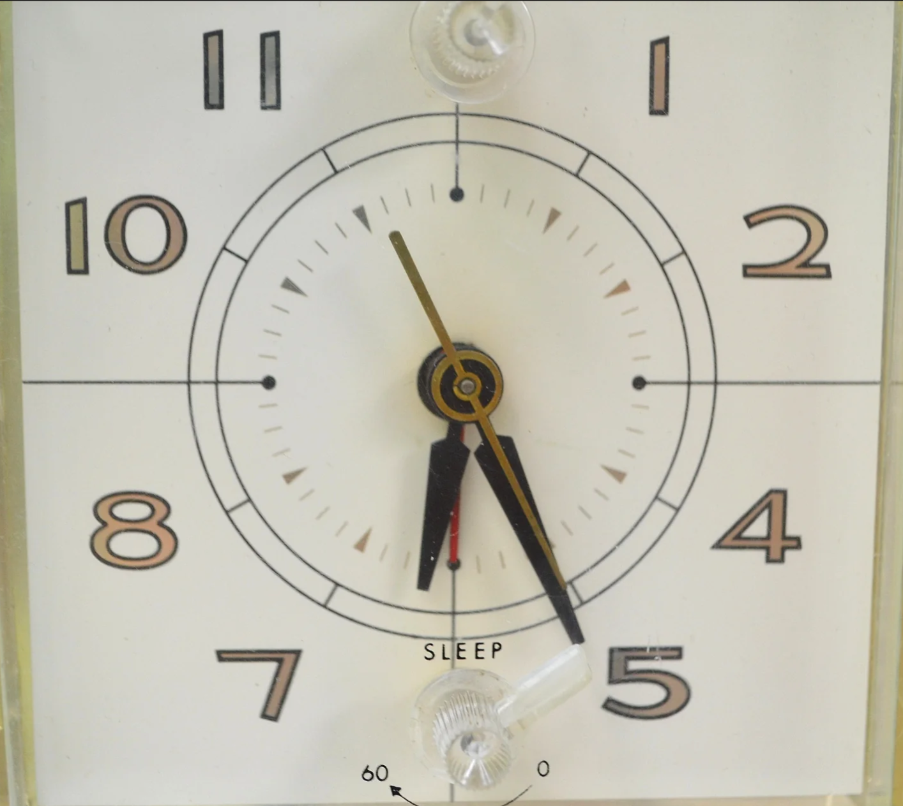
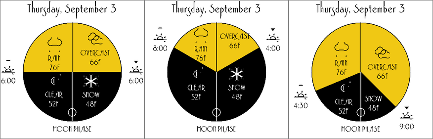

# Retro Clock-Radio

## Component List
| Part | Notes |
|---|---|
| [ESP32-S3 v1.1](https://docs.espressif.com/projects/esp-dev-kits/en/latest/esp32s3/esp32-s3-devkitc-1/user_guide_v1.1.html) | ESP32-S3-DevKitC-1 Development Board BT 2.4G Wifi Module for Arduino 8MB PSRAM 16MB FLASH N16R8 42Pin CH340C Type-C ESP32 S3. Verify your microcontroller details with [ESPConnect](https://thelastoutpostworkshop.github.io/ESPConnect/). |
| [5.83inch E-Paper Display](https://www.waveshare.com/5.83inch-e-paper-g.htm) | E-ink Display, 648 × 480, Red/Yellow/Black/White, SPI Interface |
| [Rotary Encoder](https://www.adafruit.com/product/5880) | Adafruit I2C Stemma QT Rotary Encoder Breakout with Encoder - STEMMA QT / Qwiic |

## Wiring
Defaults follow Waveshare's own ESP32-S3 reference wiring. All six are
`build_flags` in [platformio.ini](platformio.ini) — rewire freely and update
them to match.

This panel's interface is **nine** wires, not the usual eight — `PWR` is a
power-control input, and with it floating the panel never powers up.

| Panel | ESP32-S3 GPIO | Macro |
|---|---|---|
| VCC / GND | 3V3 / GND | — |
| DIN | 11 | `EPD_PIN_MOSI` |
| SCLK | 12 | `EPD_PIN_SCLK` |
| CS | 10 | `EPD_PIN_CS` |
| DC | 13 | `EPD_PIN_DC` |
| RST | 14 | `EPD_PIN_RST` |
| BUSY | 4 | `EPD_PIN_BUSY` |
| PWR | 5 | `EPD_PIN_PWR` |

Set `EPD_PIN_PWR` to `-1` only for an older 8-pin panel with no PWR pin.

The panel's mode switch must be in the **4-line SPI** position; the driver does
not implement 3-line mode.

### Troubleshooting
BUSY on this panel reads **low while busy** and high when idle — the opposite
sense of Waveshare's monochrome panels. That makes an unpowered or disconnected
panel look identical to an idle one, so the driver cross-checks the timing:

- `BUSY stuck low` — the pin is held low past `EPD_BUSY_TIMEOUT_MS`. Usually
  miswired, or shorted.
- `refresh finished in N ms` — the refresh "succeeded" far too quickly, so BUSY
  was never asserted and the panel is not responding at all. Check PWR first,
  then the mode switch, then DIN/SCLK/CS/DC.

A silent success with a blank panel should not be possible; if you see one,
that check is what failed.

### KiCad

[Espressif libraries for KiCad](https://github.com/espressif/kicad-libraries)


## Configuration
Wi-Fi credentials and connection tuning are compile-time parameters, defined as
`build_flags` in [platformio.ini](platformio.ini) — nothing is hard-coded in the
sources. Set `WIFI_SSID` and `WIFI_PASSWORD` there before the first build.

| Macro | Default | Purpose |
|---|---|---|
| `WIFI_SSID` | *(required)* | Network to join |
| `WIFI_PASSWORD` | *(required)* | Pre-shared key |
| `WIFI_HOSTNAME` | `retro-clock-radio` | Name requested from DHCP |
| `WIFI_AUTH_THRESHOLD` | `WIFI_AUTH_WPA2_PSK` | Weakest acceptable AP security |
| `WIFI_CONNECT_MAX_RETRY` | `0` | Attempts before reboot; 0 = retry forever |
| `WIFI_CONNECT_TIMEOUT_MS` | `15000` | Per-attempt deadline for assoc + DHCP |
| `WIFI_CONNECT_BACKOFF_MIN_MS` | `1000` | Initial delay between attempts |
| `WIFI_CONNECT_BACKOFF_MAX_MS` | `30000` | Backoff ceiling |
| `BOOT_LOG_DELAY_MS` | `5000` | Silent pause before the first log line |
| `NTP_SERVER` | `pool.ntp.org` | NTP server used to set the clock |
| `TIME_ZONE` | `EST5EDT,M3.2.0,M11.1.0` | Local timezone as a POSIX TZ string |
| `NTP_SYNC_TIMEOUT_MS` | `30000` | Wait for the first NTP response before continuing |
| `NTP_SYNC_INTERVAL_MS` | `3600000` | Interval between background re-syncs |
| `EPD_PIN_SCLK` | `12` | Panel CLK |
| `EPD_PIN_MOSI` | `11` | Panel DIN |
| `EPD_PIN_CS` | `10` | Panel CS |
| `EPD_PIN_DC` | `13` | Panel DC (command/data select) |
| `EPD_PIN_RST` | `14` | Panel RST |
| `EPD_PIN_BUSY` | `4` | Panel BUSY (low = busy) |
| `EPD_PIN_PWR` | `5` | Panel PWR (power control); -1 only on 8-pin panels |
| `EPD_SPI_HOST` | `SPI2_HOST` | SPI peripheral driving the panel |
| `EPD_SPI_SPEED_HZ` | `10000000` | SPI clock; the panel is rated to 20 MHz |
| `EPD_BUSY_TIMEOUT_MS` | `60000` | Ceiling on one BUSY wait (a refresh takes ~25 s) |
| `OWM_API_KEY` | *(required)* | OpenWeather API key |
| `OWM_FORECAST_PATH` | `/data/2.5/forecast` | Endpoint; `/data/4.0/onecall` requires a credit card on file |
| `OWM_LATITUDE` | *(required)* | Latitude to forecast for, decimal degrees, quoted |
| `OWM_LONGITUDE` | *(required)* | Longitude, decimal degrees, quoted |
| `OWM_UNITS` | `metric` | `standard`, `metric` or `imperial` |
| `OWM_UNITS_ENUM` | `WX_UNITS_METRIC` | The same choice for the code, which cannot compare strings |
| `OWM_POLL_INTERVAL_S` | `1800` | Seconds between fetches; 1800 is 48 calls a day |
| `OWM_MAX_CALLS_PER_DAY` | `200` | Daily cap, well under the 1000/day free tier |
| `OWM_MIN_CALL_INTERVAL_S` | `600` | Floor between attempts; what stops a reboot loop |
| `WEATHER_MOCK` | `0` | 1 = render a canned response and make no network call |

Omitting `WIFI_SSID`, `WIFI_PASSWORD`, `OWM_API_KEY`, `OWM_LATITUDE` or
`OWM_LONGITUDE` fails the build with an `#error` rather than silently producing
firmware that cannot connect or cannot forecast. Latitude and longitude are
quoted strings, not numbers: they are only ever pasted into a URL, and that
sidesteps any argument about how a float is formatted.

To keep credentials out of version control, comment those two flags out and
export them at build time instead:

```sh
export PLATFORMIO_BUILD_FLAGS='-D WIFI_SSID=\"my-ssid\" -D WIFI_PASSWORD=\"my-pass\"'
pio run -t upload -t monitor
```


## Firmware Organization
Bootstraps the ESP32-S3 (NVS, TCP/IP stack, default event loop), paints a
four-colour test pattern on the e-paper panel, joins a Wi-Fi network as a
station, then sets the real-time clock from NTP. The rotary encoder is not
driven yet.

- [src/main.c](src/main.c) — boot banner, bring-up, link/clock heartbeat
- [src/wifi_sta.c](src/wifi_sta.c) — station bring-up, retry/backoff, auto-reconnect
- [src/time_sync.c](src/time_sync.c) — SNTP client, timezone, background re-sync
- [src/epd_5in83g.c](src/epd_5in83g.c) — e-paper panel driver over SPI
- [src/epd_paint.c](src/epd_paint.c) — frame buffer shapes and a built-in 5x7 font
- [src/epd_pattern.c](src/epd_pattern.c) — the bring-up test pattern
- [src/epd_clockface.c](src/epd_clockface.c) — the analog clock face
- [src/epd_font.c](src/epd_font.c) — bitmap text; faces generated from the TTF
- [src/epd_weather.c](src/epd_weather.c) — the daily weather screen
- [src/weather_aggregate.c](src/weather_aggregate.c) — hourly forecast into four parts of a day
- [src/weather_api.c](src/weather_api.c) — the HTTPS fetch
- [src/weather_parse25.c](src/weather_parse25.c) — the free 2.5 forecast
- [src/weather_moon.c](src/weather_moon.c) — moon phase from the date
- [src/weather_display.c](src/weather_display.c) — poll, compare, redraw
- [src/weather_quota.c](src/weather_quota.c) — API call budget in NVS
- [src/clock_display.c](src/clock_display.c) — five-minute update task
- [src/refresh_count.c](src/refresh_count.c) — lifetime refresh counter in NVS

## Display
The panel is a Waveshare 5.83" e-Paper (G): 648 x 480, four inks
(black/white/yellow/red), 4-wire SPI. The driver is a port of Waveshare's
[reference code](https://github.com/waveshareteam/e-Paper/tree/master/E-paper_Separate_Program/5in83_e-Paper_G)
onto the ESP-IDF SPI master driver, streaming the frame in DMA-sized bursts
instead of one chip-select per byte.

Frames are 2 bits per pixel, four pixels per byte, leftmost pixel in the high
bit pair — the panel's own packing, so `epd_display()` ships the buffer
verbatim. A full frame is 76 KB and is allocated from PSRAM when there is any.

Only a **478 x 460** window of the glass is usable — `EPD_USABLE_WIDTH` and
`EPD_USABLE_HEIGHT` in [src/epd_5in83g.h](src/epd_5in83g.h). It is flush to the
panel's left and bottom edges (`EPD_USABLE_X` 0, `EPD_USABLE_Y` 20), so the dead
margin is the 170 columns on the right and the 20 rows along the top.

Frame buffers stay the panel's full 648 x 480, because that is what the panel
clocks in, but the paint primitives take coordinates *relative to the usable
box* — (0,0) is its top-left, not the panel's — and clip to it, so the dead
margin can only ever carry the `paint_clear()` colour. Layout code works in the
box and never has to know about the rest.

`app_main()` puts the clock face up first, before Wi-Fi, so a wiring fault
surfaces immediately rather than behind a network timeout. Swapping the
`epd_clockface_show()` call for `epd_pattern_show()` boots the test pattern
instead. Neither an init failure nor a
BUSY timeout is fatal. A full refresh takes roughly 25 seconds, during which
`app_main()` blocks.

### Test pattern
The boot pattern is a bring-up check, laid out inside the 478 x 460 usable box
and readable at a glance:

- **All four inks** — labelled swatches, one per colour code (0–3).
- **Orientation** — every edge is named, a red arrow points at the top edge,
  and each corner carries both a coordinate label and a distinct shape (red
  square, yellow disc, black triangle, four-ink checker). Reading the text also
  catches a mirrored scan direction, which a symmetric pattern would hide.
- **Geometry** — a frame flush to all four sides of the usable box plus edge
  ticks spanning corner to corner; a row-stride error skews them, a wrong
  resolution register stops them short. Corner labels read `(477,0)` and
  `(477,459)` — box coordinates, not the panel's — so a frame that does not sit
  hard against the visible edges, or a strip of white above the top one, means
  the crop is wrong.

_The full panel size is not used!_
This project needed a smaller panel size that could not be found, so a larger one was used instead. 


### Clock face
[src/epd_clockface.c](src/epd_clockface.c) draws the dial inspired by
[docs/pictures/clock-face.png](docs/pictures/clock-face.png): outlined numerals
outside a two-line chapter ring, an inner minute track with wedges on the fives,
cross lines running out to the edges.

The hands follow the pair in the photograph: solid black tapered wedges, broad
at the boss and narrowing to a blunt tip, with the boss drawn over both. No
second hand — see the cadence below for why there could not be one.




#### Type
Both screens set type from `fonts/Aesthetic Rigelsia Free.ttf`, rasterised to
bitmaps by [tools/make_font.py](tools/make_font.py) into the generated
[src/epd_font_data.c](src/epd_font_data.c). The panel has no font engine, so the
glyphs are baked at the sizes they are drawn:

| Face | Size | Charset | Used by |
|---|---|---|---|
| `FONT_DIAL` | pt60 | digits | clock numerals |
| `FONT_TITLE` | pt40 | mixed case | the weather heading |
| `FONT_LABEL` | pt26 | caps and digits | everything smaller |

Rasterising uses ImageMagick, which is the only thing to hand that reads a
TrueType outline. Per glyph it renders at a known pen position and finds the ink
box — that yields the offset from the *baseline*, without which ascenders and
descenders cannot be aligned — and measures the advance as
`width("cc") - width("c")`, since ImageMagick reports a label's extent but not a
glyph's advance. Sizes are fixed rather than scaled: a thin Deco face carries its
character in two- and three-pixel strokes, and scaling a bitmap that fine
destroys the thing worth keeping. Below about pt24 the strokes start breaking up
when thresholded to one bit, which is what sets `FONT_LABEL`.

All type is black. The dial used to set its numerals in yellow behind a black
outline, which suited the blocky face it had then; a one-pixel outline on a
three-pixel stem leaves nothing.

## Weather

Weather data is supplied by the free tier at [OpenWeather.org](https://openweathermap.org/).
This uses the version [2.5 of the API](https://openweathermap.org/api/current?collection=current_forecast), which does not require any kind of payment or even a credit card on file. You simply register for an API key.
*This is the version used by this application.*

The latest [version 4.0 of the One Call API](https://openweathermap.org/api/one-call-4?collection=one_call_api) has more features and it is also free up to a sufficient number of daily requests, but requires a credit card on file (even if the free usage is not exceeded).

---
[src/epd_weather.c](src/epd_weather.c) draws the screen:
the date across the top, a circle quartered into the four parts of the day, each
with an icon, a condition and a temperature, sunrise and sunset in the margins,
and the moon phase at the foot.



The circle is a **twenty-four hour dial**: noon at the top, midnight at the foot,
running clockwise, so morning is upper-left, afternoon upper-right, evening
lower-right and night lower-left.

Noon and midnight never move, so that divider is always vertical. Sunrise and
sunset are drawn **where they actually fall**. A six o'clock sunrise lands due
left and a six o'clock sunset due right, giving the flat horizontal of the
mock-up; anything else tilts. A late sunrise swings the left divider up above the
horizontal, an early one dips it below, and the sunset divider does the same on
the right. The four parts of the day are therefore drawn at the size they really
are — a long June evening looks long — and the sunrise and sunset icons ride
their own dividers up and down with them.

Sectors are inked by whether the sun is up: **yellow while it is, black once it
is not**, with the text and icons black on yellow and white on black. Two
consequences worth knowing:

- The proportion of yellow *is* the day length. A December dial is mostly black,
  a June one mostly yellow, and that reads before any of the words do.
- The noon-to-midnight divider is drawn black above the centre and white below.
  Above, it separates two yellow sectors; below, two black ones, where a black
  line would not exist. The sunrise and sunset dividers are not drawn at all —
  they separate a yellow sector from a black one, and that edge is already the
  sharpest thing on the screen.

The moon sits wholly inside the rim rather than straddling it as the mock-up
shows, because the foot of the dial is now black: the glyph is drawn white and
has to stay on that background. Its label drops below the rim onto the page.

Each sector's contents sit out along the middle of its arc, at a radius computed
from the width of that sector's own label. A wedge widens as it goes out, so a
narrow one pushes its contents outward to find room; the test is against the
group's *innermost corner*, which is the first thing a divider reaches. When even
the outermost usable radius is too tight — a deep summer evening can be 45° —
the icon is dropped and the text pushed further out, because a divider drawn
through the word is worse than no picture.

| Part | Runs from | to |
|---|---|---|
| Morning | sunrise | local noon |
| Afternoon | local noon | sunset |
| Evening | sunset | local midnight |
| Night | local midnight | sunrise |

### Where the four conditions come from
A One Call `daily` entry carries **one** condition for the whole day; only its
*temperatures* are split into morning, day, evening and night. The four
conditions therefore have to be aggregated out of the 48-hour `hourly` array,
which is what [src/weather_aggregate.c](src/weather_aggregate.c) is for.

Selection is tiered rather than a straight "worst wins". OpenWeather reports
`500 light rain` for any hour with a trace of modelled precipitation, including
ones it gives a six percent chance, so ranking those straight up a severity
ladder would paint most of the year as rain and the icon would stop meaning
anything.

- **Hazards** — thunderstorm, snow, sleet, squall — take the window on a single
  hour. One storm hour in an otherwise clear afternoon is exactly what must not
  be averaged away.
- **Rain** must either persist for a quarter of the window or carry a strong
  chance of precipitation.
- **Everything else** is decided on *mean* cloudiness, re-binned on
  OpenWeather's own icon thresholds. Taking the mode of already-binned values
  makes the icon flip when three hours at 26% meet two at 24%.
- **Fog** only when it holds the majority; dawn mist that burns off by nine
  should not own the morning.

The hourly array begins at the *current* hour and holds no history, so by
evening there is nothing left to aggregate for the morning. Gaps fall back, best
first, to an earlier poll from the same day (kept in NVS) and then to the day's
own single condition. Each window records which of the three it used.

### Icons
Drawn, not downloaded — [tools/make_weather_icons.py](tools/make_weather_icons.py)
into the generated [src/weather_icons_data.c](src/weather_icons_data.c).
OpenWeather serves 100×100 anti-aliased colour PNGs, which would need a decoder
this firmware does not carry and would come out as blobs in four inks; the
mock-up is line art regardless.

Each icon is described as a solid silhouette taking an `inset`, and the outline
is the silhouette minus a smaller copy of itself — one rule applied to every
closed shape, which is what keeps the set looking like one hand drew it. Marks
with no inside (sun rays, rain, the bolt) are drawn solid at final weight.
Thirteen conditions share ten glyphs; the eight moon phases are picked from
`moon_phase`.

### Polling and refreshing
Two different rates, deliberately. The forecast is fetched every **30 minutes**
(48 calls a day), but the panel is only refreshed when the screen would actually
differ — an unchanged forecast costs nothing, which matters for a panel rated
for a million refreshes. The 180 s floor from the panel datasheet is enforced
here as it is on the clock face.

The weather screen owns the panel for now. The clock face is still built and
still works; `clock_display_start()` brings it up, and the two become switchable
once the rotary encoder is driven.

### Which endpoint, and why
The firmware calls **`data/2.5/forecast`** — three-hourly, five days — because
that is what an ordinary OpenWeather key can reach.

One Call (`data/4.0/onecall`) is hourly and richer, and
[src/weather_parse.c](src/weather_parse.c) still handles it, still under test.
But it needs its own *One Call by Call* subscription and returns 401 without one:

> `{"cod":401, "message": "Please note that using One Call 3.0 requires a
> separate subscription to the One Call by Call plan..."}`

The version in the path makes no difference. The docs page is titled "One Call
4.0", but its own examples call `data/3.0/onecall`, and the server accepts
either — tested, both return that same 401 for an unsubscribed key, each echoing
back the version asked for. A wrong path would give 404. `weather_api.c` logs
the server's message verbatim on any non-200, which is what tells those apart.

To move to One Call after subscribing: point `OWM_FORECAST_PATH` at
`/data/3.0/onecall` and call `weather_parse()` instead of `weather_parse25()` in
`weather_display.c`.

### What the free endpoint costs
Three things One Call would have given, and how each is covered:

| Missing | Covered by |
|---|---|
| 1-hour granularity | 3-hour samples; a window gets 2–4 instead of 6–8 |
| `daily.temp.morn/day/eve/night` | The mean of each window's own samples |
| `moon_phase` | [src/weather_moon.c](src/weather_moon.c), computed from the date |

Deriving the temperature per window is arguably the better answer: One Call's
four periods are fixed to its own definitions, whereas a mean over the window is
by construction the temperature of the period drawn beside it. It also settles
the ambiguity in what `temp.night` refers to.

`city.sunrise`/`city.sunset` are **today's only**, which is why the screen draws
today and nothing else. Aggregating another day against them collapses the
windows — the boundary clamp keeps that safe rather than nonsensical, but the
result is meaningless.

### Call budget
The free One Call tier allows 1000 calls a day. The cap is not the real risk — a
crash loop is, since each restart would otherwise make a call. So
[src/weather_quota.c](src/weather_quota.c) keeps three persistent brakes in NVS:

- a **daily cap** (default 200, well under the tier);
- a **minimum interval** between attempts (default 600 s), which is the brake
  that actually stops a reboot loop;
- **reserve before spend** — the counter is committed *before* the socket opens,
  so a crash inside the TLS handshake still costs budget. There is no refund on
  failure, because a request that failed locally may well have reached the server.

The day key is **UTC**, not local: OpenWeather meters against 00:00 UTC, and a
local key in a western timezone would roll over hours late and allow up to twice
the cap inside one of the server's days. Fetches are gated on the clock being
set — an unset clock reads as UTC day zero and would reset the counter on every
cold boot. Rollover only ever moves forward, so a backwards clock step cannot
clear the count either.

### Testing without the network
`WEATHER_MOCK=1` renders from a canned response and makes no call. The payload is
baked into [src/weather_mock_data.h](src/weather_mock_data.h) from a fixture, so
device and host exercise the same bytes; it costs 20 KB of flash, so leave it off
in a real build. There is exactly one `#if` in the production path, at the top of
`weather_api_fetch()` — parse, aggregate, render and schedule are identical either
way.

The pure modules build on a host with plain gcc:

```sh
sh tools/run_host_tests.sh          # parser and aggregator, ~40 assertions
python3 tools/make_weather_fixtures.py
```

Fixtures cover a baseline day, the low-confidence-drizzle trap, a device booted
after dark, a polar day with no sunrise, and a 401 body. The awkward cases need
no fake clock: the aggregator takes the day boundaries as arguments, so a test
poses "booted at eight in the evening" by passing different numbers.

